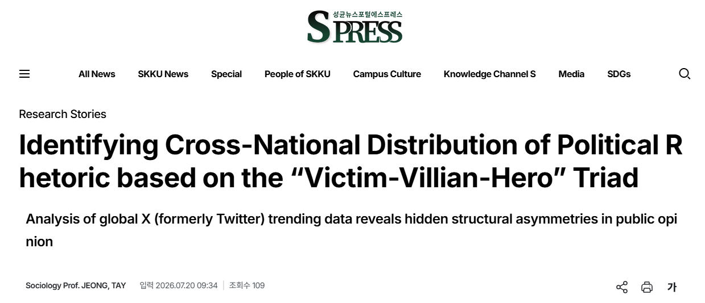

Professor Tay Jeong of the Department of Sociology has analyzed the characteristics of global hashtag movements during the early stages of the Gaza war, drawing on country-specific trending data from social media platform X (formerly Twitter) and a new role-based analytical framework. The study has drawn considerable attention in academic circles for offering a clear and accessible theoretical lens on the flow of wartime public opinion on social media.

The Gaza war, which broke out in October 2023, sparked wide-ranging political debate from its earliest days. The study takes as its starting point a debate among the global "progressive" intelligentsia over the symmetry of the conflict. While many mainstream Western intellectuals argued that both sides were driven by primal vengeance, others countered that Palestinian resistance should be understood not as an expression of hatred or revenge but as an expression of hope for liberation.

To address this question, Professor Jeong introduced the "Victim–Villian–Hero" model as a qualitative tool for analyzing political oratory. He systematically classified and analyzed war-related hashtag slogans that trended on X across 62 countries worldwide according to this three-role framework.

Pro-Palestinian hashtag movements worldwide were dominated by voices highlighting victims' suffering and calling for peace (e.g., #GazaUnderAttack, #CeasefireNOW). However, modes of expression varied by region. Users in Western countries such as those in Europe and the United States tended to emphasize "humanitarian sympathy," mourning victims' suffering and calling for an end to violence, whereas users in Middle Eastern and Arab countries more strongly invoked "heroism," framing victimhood alongside courage and resistance in the face of hardship.

This divide is often framed as a West-versus-non-West opposition, but the study finds that, at least in the case of the current Gaza war, the more salient divide is between Arab and non-Arab countries. Contrary to the assumption that the global pro-Palestinian movement is primarily an expression of primal vengeance or antisemitism, slogans condemning or attacking Israel were relatively rare; militant support for Palestine was instead expressed predominantly through the language of heroism.

By contrast, pro-Israel hashtag movements were centered on messages condemning and denouncing the "villian" (e.g., #HamasTerrorists), with heroic framing almost entirely absent—a notably distinct pattern. Professor Jeong explains that in conflicts marked by a significant power asymmetry, the weaker side tends to invoke the image of the "hero" to sustain hope, while the more powerful side tends to focus more on denouncing the adversary to justify its violent counterinsurgency campaigns.

Professor Tay Jeong stated, "Since the outbreak of the Gaza war, long-standing themes concerning violence by colonized subjects—including the symmetry and asymmetry of political rhetoric, humanitarianism versus anti-imperialism, and the divide between the West and non-West—have been actively discussed, yet these concepts have lacked systematic theorization and empirical validation." He added, "I hope this study contributes, even modestly, to clearing up misunderstandings about the global pro-Palestinian movement."

▲ Structural Changes in Regional Pro-Palestine Public Opinion and Comparison of Total Hashtag Volume Over Time

[Read the original article](https://www.spressnews.com/news/articleView.html?idxno=138492)

<!--more-->
      