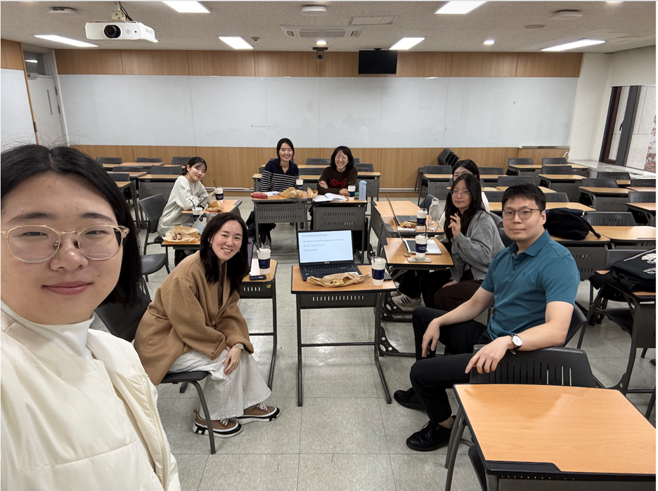

#### Sharing research interests and perspectives to broaden interdisciplinary understanding

October 29, 2026, Business Building, Room 33305

#### FiND Lab
Families of Individuals with Neurodevelopmental Disabilities Research Lab

Director: Professor Chung Eun Lee, Department of Child Psychology and Education

#### Presentation by Professor Chung Eun Lee (FiND Lab)
Masking and camouflaging behaviors that autistic women use to hide their autistic traits or to meet social expectations, and the mental health difficulties they experience in the process

#### Presentation by Professor Tay Jeong (Korea Tricontinent Research Atelier)
Explaining gender conflict among Korea’s younger generations (the so-called “MZ generation,” i.e., Millennials and Gen Z) through the political particularities of the right wing that emerged in the process of decolonization

[Read about this event on the Child Psychology and Education department website](https://skb.skku.edu/child/news.do?mode=view&articleNo=227957)

<!--more-->