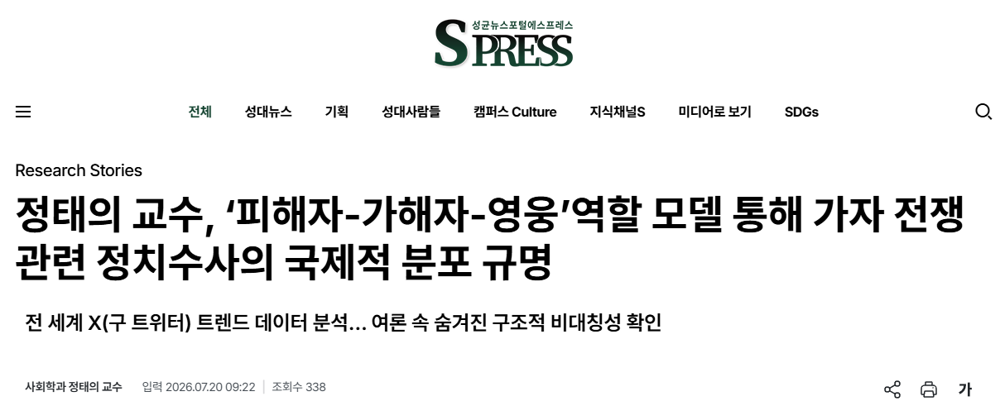
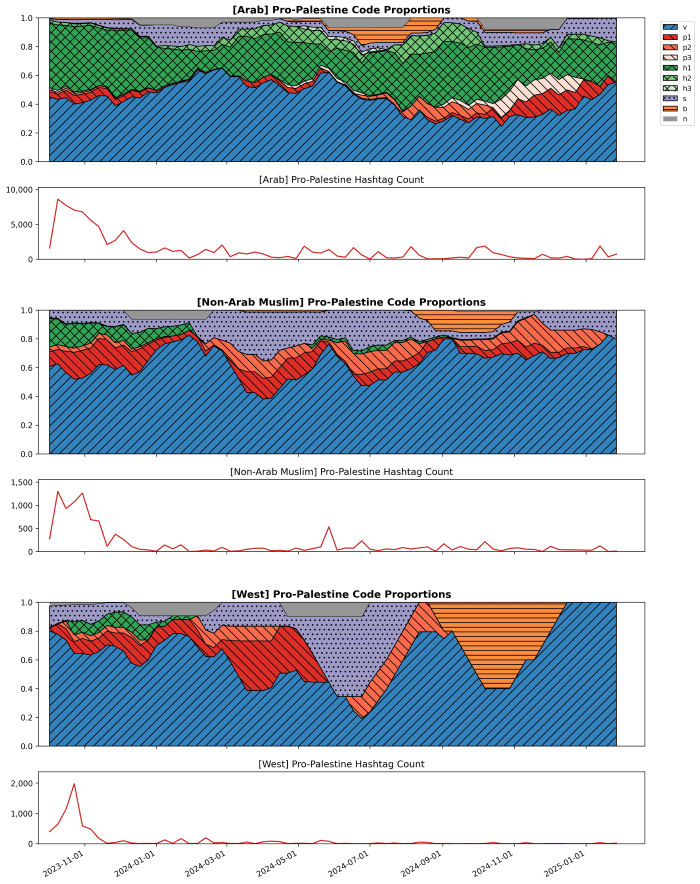

사회학과 정태의 교수가 소셜미디어(X, 구 트위터)의 국가별 트렌드 데이터와 새로운 ‘역할 기반 분석 틀(Framework)’을 활용하여, 가자지구 전쟁 초기 전 세계 온라인 공간에서 일어난 해시태그 운동의 특성을 분석했다. 이번 연구는 소셜미디어 속 전쟁 여론의 흐름을 간단하고 명쾌한 이론적 틀로 풀어내어 학계의 큰 주목을 받고 있다.

2023년 10월 발발한 가자 전쟁은 초기부터 광범위한 정치적 논쟁을 불러일으켰다. 저자는 특히 세계적 “진보”지식인들 사이에서 일어난 전쟁의 대칭성에 대한 논쟁을 연구의 출발점으로 삼았다. 전쟁 양측이 모두 원초적 복수심에 이끌려 행동하고 있다는 주장이 서방의 주류 지식인들에게 의해 널리 주장되었지만, 팔레스타인의 저항을 증오심이나 복수심보다는 해방을 위한 희망의 표출로 보아야 한다는 반론이 있었다..

정태의 교수는 이 문제를 풀기 위해 정치적 수사를 기초적으로 구성하는 세 가지 핵심 역할인 ‘피해자(Victim)-가해자(Villain)-영웅(Hero)’ 모델을 도입했다. 동시에 전 세계 62개국의 X 트렌드에 나타난 전쟁 관련 해시태그 슬로건을 이 세 가지 역할 모델에 맞춰 꼼꼼하게 분류하고 분석하는 작업을 거쳤다.

팔레스타인을 지지하는 해시태그 운동은 전 세계적으로 ‘피해자’의 고통을 알리고 평화를 요청하는 목소리(#GazaUnderAttack, #CeasefireNOW)가 대다수였다. 하지만 사용자가 사는 지역에 따라 표현 방식에 차이가 있었다. 유럽과 미국 등 서구권 사용자들은 피해자의 아픔에 슬퍼하고 무력 충돌을 멈추자는 ‘인도주의적 동정’에 집중한 반면, 중동 아랍권 국가들은 피해자라는 생각과 더불어 힘든 상황을 이겨내려는 용기와 항전을 뜻하는 ‘영웅주의’ 슬로건을 강하게 표현했다.

 이와 같은 차이는 흔히 서방 대 비서방의 대립으로 생각되었지만, 적어도 현 가자 전쟁에 관해서는 비아랍권대 아랍권으로 크게 나뉘는 것이 확인되었다. 전 세계적 친팔레스타인 운동이 원초적 복수심이나 반유대주의의 발현이라는 인식과는 달리 이스라엘을 비난하거나 공격하는 구호는 매우 적게 나타났으며, 팔레스타인에 대한 전투적 지지는 대부분이 영웅주의에 기반하여 표현되었다.

이와 반대로, 이스라엘을 지지하는 해시태그 운동은 상대를 비판하는 ‘가해자 규탄 및 고발’메시지(#HamasTerrorists)가 중심을 이루었고, 영웅을 강조하는 내용은 거의 발견되지 않는 독특한 모습을 보였다. 정태의 교수는 힘의 차이가 큰 분쟁 상황에서 약자 측은 희망을 품기 위해 '영웅'의 이미지를 찾는 반면, 강자 측은 자신들의 행동을 정당화하기 위해 상대를 지적하는 '가해자 규탄'에 더 집중하게 된다고 설명했다.

 정태의 성균관대 교수는 “가자 전쟁 발발 이후 정치적 수사의 대칭성과 비대칭성, 인도주의 대 반제국주의, 서방과 비서방의 간극 등 피식민 주체들에 의한 폭력과 관련한 오래된 주제들이 활발하게 논의되었지만, 개념의 체계화가 부족한 상태였으며 경험적인 검증도 부족한 상황이였다”며 “이번 연구가 세계적 친팔레스타인 운동에 대한 오해를 해결하는데 조금이나마 도움이 되기를 바란다”고 전했다.

▲ 시간 경과에 따른 지역별 친팔레스타인 여론의 구조 변화 및 해시태그 총량 비교

[기사 원문 보기](https://www.spressnews.com/news/articleView.html?idxno=138490)

<!--more-->

      