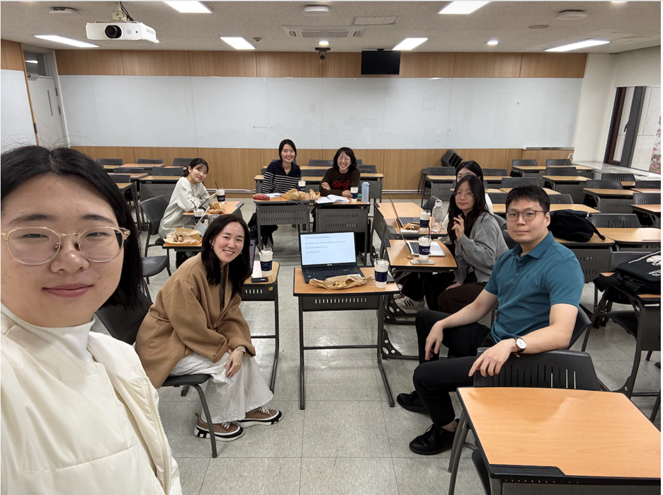

#### 연구 관심과 관점을 공유하고 학문 간 이해를 넓히기 위함

2026년 10월 29일, 경영관 33305호

#### FiND Lab
Families of Individuals with Neurodevelopmental Disabilities Research Lab

책임자: 아동청소년학과 이정은 교수

#### FiND Lab 이정은 교수 발표
자폐 여성이 자신의 자폐 특성을 감추거나 사회적 기대에 맞추기 위해 사용하는 마스킹과 위장행동과 그 과정에서 경험하는 마음건강의 어려움

#### 한삼공방 정태의 교수 발표
한국 MZ(Millennials and Gen Z)세대의 젠더갈등을 탈식민 과정에서 나타난 우익의 정치적 특수성을 통해 설명

[이 행사 관련 아동청소년학과 게시글](https://skb.skku.edu/child/news.do?mode=view&articleNo=227957)

<!--more-->

      